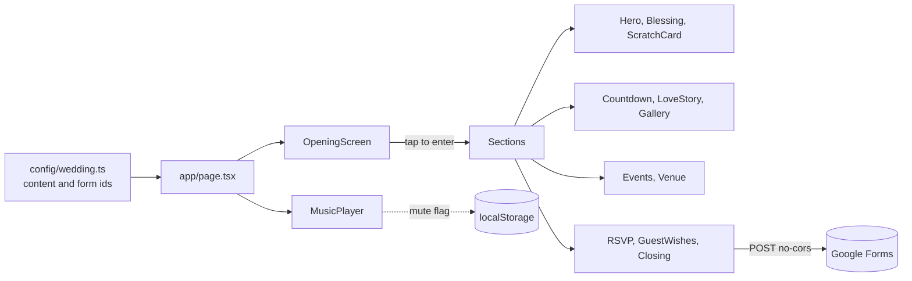

<div align="center">
  

  <p><code>A cinematic, mobile-first digital wedding invitation with RSVP, live countdown, polaroid gallery and love story.</code></p>

  <a href="https://sajid-weds-dilruba.vercel.app"></a>
  <a href="https://github.com/Saji-d/my-wedding-invitation"></a>
  
  <br>
  
  
  
  
  
  
  

  <p>
    <a href="#-overview">Overview</a> · <a href="#-highlights">Highlights</a> · <a href="#-preview">Preview</a> · <a href="#-architecture">Architecture</a> · <a href="#-tech-stack">Tech Stack</a> · <a href="#-getting-started">Getting Started</a> · <a href="#-project-structure">Structure</a> · <a href="#-roadmap">Roadmap</a> · <a href="#-author">Author</a>
  </p>
</div>


## ◈ Overview

A personal project: the digital invitation for the wedding of Sajid and Dilruba. Instead of a static card, guests open an animated experience that tells the couple's story, shows the schedule, counts down to the day and lets them reply from their phone.

It is a single-page Next.js app. All the content (names, date, venue link, timeline, gallery captions, quotes, form field ids) lives in one typed config file, so the whole invitation can be re-skinned for another event without touching the components.


## ◈ Highlights

<table>
  <tr>
    <td width="33%"><b>Cinematic entry</b><br>An opening screen with a tap to enter, which also starts the background music.</td>
    <td width="33%"><b>Live countdown</b><br>Days, hours, minutes and seconds to the ceremony, computed with date-fns.</td>
    <td width="33%"><b>Polaroid gallery</b><br>A Swiper card-stack gallery with autoplay, keyboard control and captions.</td>
  </tr>
  <tr>
    <td><b>Love story timeline</b><br>Six milestones from the first date to the wedding day, with photos.</td>
    <td><b>RSVP and guest wishes</b><br>Forms post straight to Google Forms, so replies land in a sheet with no backend. Confetti on acceptance.</td>
    <td><b>Scratch card reveal</b><br>A canvas scratch-off that uncovers the wedding date.</td>
  </tr>
  <tr>
    <td><b>Venue and directions</b><br>Venue section with a one-tap link to Google Maps.</td>
    <td><b>Music player</b><br>Background track with a mute toggle that remembers the choice in localStorage.</td>
    <td><b>Ambient effects</b><br>Floating petals, glass panels and a scroll-to-top button near the end.</td>
  </tr>
</table>


## ◈ Preview

<div align="center">
  
</div>

Design language: burgundy, gold, champagne and ivory, set in Great Vibes, Playfair Display and Cormorant Garamond.


## ◈ Architecture




## ◈ Tech Stack

| Layer | Technologies | Purpose |
|---|---|---|
| Framework | Next.js 16 (App Router), React 19, TypeScript | Page shell, fonts, image optimisation |
| Styling | Tailwind CSS 4, CSS variables | Luxury theme and responsive layout |
| Motion | Framer Motion, Swiper (EffectCards) | Scroll reveals, transitions, gallery |
| Interaction | canvas-confetti, HTML canvas | Confetti and scratch card |
| Data | Google Forms (fire and forget POST) | RSVP and guest wishes, no server |
| Utilities | date-fns, react-icons | Countdown maths and icons |
| Hosting | Vercel | Deployment |


## ◈ Getting Started

Prerequisites: Node.js 20 or newer and npm.

```bash
git clone https://github.com/Saji-d/my-wedding-invitation.git
cd my-wedding-invitation
npm install
npm run dev      # http://localhost:3000
```

```bash
npm run build    # production build
npm run start    # serve the build
npm run lint
```

No environment variables are needed. To adapt it, edit `src/config/wedding.ts` (names, date, venue link, timeline, gallery, form entry ids) and replace the files in `public/images` and `public/music`.


## ◈ Project Structure

<details>
<summary>Show tree</summary>

```text
src/
  app/            layout.tsx, page.tsx, globals.css
  components/
    layout/       BackgroundEffects
    sections/     OpeningScreen, Hero, WordsFromTheHeart, IslamicBlessing,
                  ScratchCard, Countdown, LoveStory, Gallery, Events,
                  Venue, RSVP, GuestWishes, Quotes, Closing
    ui/           MusicPlayer
  config/         wedding.ts
public/
  images/         gallery, love_story
  music/
```

</details>


## ◈ Roadmap

- [x] Animated entry, hero, countdown, gallery and love story
- [x] RSVP and guest wishes through Google Forms
- [ ] Remove unused dependencies (mapbox-gl, EmailJS and GSAP are installed but not imported)
- [ ] Move contact details out of the public config file
- [ ] Optional light and dark theme toggle


## ◈ Author

**Sajidur Rahman Sajid** - Full-Stack Developer and AI engineer, Dhaka.

[Portfolio](https://www.sajidur.me) · [LinkedIn](https://www.linkedin.com/in/sajidur-rahman-sajid/) · [GitHub](https://github.com/Saji-d) · [Email](mailto:sajidsajidurrahman99@gmail.com)

<sub>Built with love for a very special day.</sub>
